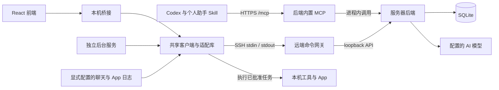

# 栖忆 · 个人助手

从日常 AI 对话和 App 使用记录中整理个人偏好、习惯、需求、目标、背景与边界，让不同设备和 Agent 共享一份可人工维护的个人上下文。

这是一个可运行的 TypeScript 首版：React 管理界面、独立服务器、SSH 命令网关、共享适配库和无界面后台进程均已实现。当前面向**一个人的多台设备**，不是多人 SaaS。

现在也提供 **Qt 桌面前端**，截图、资料库、Agent 对话和个人记忆均属于本项目，无需其他同层项目。桌面资料和个人记忆默认保存本地；只有手动选中并确认的记忆、概述及关联原件才上传服务器。双击 `start-desktop.command` 启动，源码构建运行 `./build-desktop.sh`。使用与数据边界见 [桌面前端说明](docs/desktop.md)。

桌面读图使用独立临时 Agent：每份截图接收固定提示词与图片，概述直接写入文件并通知界面刷新，然后退出。持久问答 Agent 优先读取概述，需要细节时才核对原件；读图程序、启动参数与 Codex 思考深度可单独配置。

## 本机启动

需要 Node.js 24 LTS（本次验证为 24.18.0）与 npm。所有命令从项目根目录运行。

```bash
npm ci
npm run setup
npm run dev
```

打开 [http://127.0.0.1:5173](http://127.0.0.1:5173)。三个进程分别是后端 `4310`、本机桥接 `4311`、Vite 前端 `5173`。首次 `setup` 创建带随机密钥、权限为 `0600` 的 `.env`；已有文件不会被覆盖。

当前工程已安装依赖并生成 `.env`，可直接运行 `npm run dev`。如果 npm 全局缓存不可写，可为 `npm ci` 增加 `--cache /tmp/qiyi-npm-cache`，无需修改全局缓存权限。

初次启动是空白空间，不读取任何真实聊天目录，也不会调用模型。你可以：

1. 在「我的资料」手动添加个人偏好等信息。
2. 在「信息来源」创建一个“通用聊天 JSONL”来源，导入 `examples/chat.jsonl`，先预览再上传。
3. 配置模型后点击“分析信息”，在「我的资料」确认提取结果。
4. 在「自动行动」创建、检查并批准一条笔记任务；本机适配器会写入 `data/outputs/`。
5. 在「个性化上下文」复制或导出确认后的资料。

## 已实现的能力

| 部分       | 能力                                                                                                |
| ---------- | --------------------------------------------------------------------------------------------------- |
| 个人资料   | 六类记忆、标签、置信度、人工新增/编辑/删除、待确认/已确认/已忽略、关键词筛选                        |
| 证据管理   | 原始记录分页、编辑/删除、来源追溯、证据变化标记；失效证据对应的资料不进入个性化上下文               |
| 导入       | Codex rollout JSONL、通用聊天 JSONL、App 使用事件 JSONL；网页上传和目录后台轮询共用解析与上传逻辑   |
| AI 分析    | 可配置 OpenAI 兼容 Chat Completions 接口；服务端校验结构和证据，输出候选资料，不覆盖已有人工资料    |
| 跨设备通信 | 浏览器 → 本机桥接 → `ssh` 子进程 → 远端网关 → 后端 API；请求 JSON 通过 stdin，响应 JSON 通过 stdout |
| 自动行动   | 设备注册、工具白名单、任务编辑/批准/取消、原子认领、结果回报、超时处理；内置笔记与上下文导出工具    |
| 无界面运行 | 同一个 `AdapterRuntime` 可在桥接服务、桌面端宿主或独立 daemon 中使用                                |
| 数据       | SQLite WAL、导入去重、删除记录的防复活标记、版本冲突检查、JSON 导出                                 |

所有业务内容都可以在界面编辑或删除。记录 ID、版本号、来源证据和时间等系统追踪字段由服务维护；SSH 密钥、模型凭证、采集目录及命令白名单通过对应机器的配置文件维护，不通过浏览器修改。

## 项目结构

```text
apps/
  web/        React 管理界面，只依赖浏览器可用的共享库
  server/     Fastify API、内置 HTTP MCP、SQLite、AI 提取、可选 SSH 网关入口
  bridge/     仅监听本机的浏览器桥接，同时运行适配器
  daemon/     独立运行适配器，不启动浏览器或网页服务
  desktop/    本地优先的桌面后端；qt/ 是 C++ / Qt 界面与交互测试
  capture/    Swift 截图服务、平台适配、Agent 协议、资料库与测试
packages/
  contracts/  Zod 校验、实体类型、RPC 方法契约
  client/     类型化 API 客户端、HTTP 传输；/node 导出 SSH 传输
  adapters/   纯解析、上传、核心运行器；/node 提供采集、工具与宿主工厂
  http-support/ server 与 bridge 共用的 HTTP 错误映射
docs/         架构、API、适配器、部署和验证记录
deploy/       HTTPS MCP 反向代理、SSH 网关、systemd、macOS launchd 模板
examples/     明确标注的示例数据与配置
skills/       可安装的个人助手 Codex Skill
tests/        数据语义、集成、协议和适配器验证
```



Codex 通过 HTTPS 直接访问后端 `/mcp`，不经过 SSH。网页与适配端使用独立的传输配置：本机开发用 `TRANSPORT=http`，现有远端部署可继续使用 `TRANSPORT=ssh`。配置步骤见 [部署说明](docs/deployment.md)。

## Codex 接入

后端内置的 HTTP MCP 提供 `get_personal_context`、`propose_preference`、`list_action_tools` 和 `create_pending_task` 四个工具，在同一进程内调用业务服务。Codex 通过 HTTPS 直连，使用独立 `MCP_TOKEN`，无需本机 MCP 进程或 SSH。新偏好进入待确认状态，新任务进入待批准状态；重试使用原 UUID 和参数，不重复创建或覆盖人工修改。

```bash
# 在服务器上（本机开发也可将本机作为服务器）
npm run setup:mcp     # 生成 .env.mcp 和独立令牌；已有文件不覆盖
# 设置 MCP_URL=https://你的域名/mcp，并按 deploy/Caddyfile 配置 HTTPS
npm run build
npm run start:server  # 同时提供 API 与 MCP；默认仍只监听 loopback
```

在 Codex 所在电脑的 `.env.mcp` 中配置同一个 `MCP_URL` 和 `MCP_TOKEN`，完成构建后执行：

```bash
npm run codex:config  # 将私有 Codex 配置片段写入 .local/qiyi-mcp.toml
npm run install:skill # 安装到用户 Skill 目录；已有同名 Skill 不覆盖
```

将生成的私有片段合并到现有 Codex 配置后，可以请求“根据我的偏好回答”“记住这个长期偏好”或“交给个人助手创建笔记任务”。前端 bridge / 执行端 daemon 独立运行，用户仍在网页确认资料和批准任务。完整接入、凭证配置和示例见 [Codex MCP 与 Skill](docs/codex-mcp.md)。

## AI 配置

在**服务器** `.env` 填写以下项后重启后端：

```dotenv
MODEL_BASE_URL=https://your-provider.example/v1
MODEL_NAME=your-model-id
MODEL_API_KEY=your-api-key
MODEL_JSON_MODE=true
```

`MODEL_BASE_URL` 是包含版本前缀的基础地址，不包含 `/chat/completions`。本地模型可使用 `http://127.0.0.1:1234/v1`，API key 可以为空；远端模型要求 HTTPS。模型名由你选择，没有隐式默认或付费调用。

兼容接口应支持 `messages`、`store: false` 和 JSON 输出；若提供商不支持 `response_format`，设 `MODEL_JSON_MODE=false`，服务仍会严格校验返回 JSON。单批最多 25 条记录、约 70,000 字符输入，不保证任意小上下文模型都能容纳。没有配置模型、超时、拒绝、截断、格式错误或虚构证据均明确失败，不使用规则冒充 AI 输出。

默认只在你点击“分析信息”后请求模型。来源勾选“上传后自动分析”表示允许服务端每 30 秒处理该来源的待分析数据；第一次失败后会持久暂停自动请求，修复后手动分析成功即可恢复。提取结果始终先进入待确认状态。

## 后台运行与构建

```bash
npm run check          # 类型检查 + 回归测试 + 生产构建 + 独立包消费验证
npm run build
npm run start:server   # 在服务器上
npm run start:bridge   # 在本机；提供构建后的前端 http://127.0.0.1:4311
npm run start:daemon   # 在本机；不提供网页，仅采集和执行任务
npm run daemon -- --once # 开发时只同步一次，适合外部调度
```

同一台机器正常使用时选择 bridge 或 daemon 其一；多设备使用不同 `deviceId`。生产运行需要 `dist/`、生产依赖、`package.json`、配置文件和数据目录。服务安装模板不会被自动启用。

## 接入与边界

- [架构与数据规则](docs/architecture.md)
- [API 方法与错误约定](docs/api.md)
- [聊天、App 事件和工具适配](docs/adapters.md)
- [SSH、服务器与后台服务部署](docs/deployment.md)
- [验证记录与已知限制](docs/verification.md)
- [独立共享包与持续集成](docs/packaging.md)
- [Codex HTTP MCP 与个人助手 Skill](docs/codex-mcp.md)

首版的 App 使用信息来自应用自行导出的 JSONL 或你编写的采集器；没有默认监控全系统活动。主动行动是“已批准的任务由后台自动执行”，尚未加入让 AI 无约束地规划并操作任意 App 的功能。浏览器无法直接执行 SSH，所以需要本机桥接；移动浏览器可使用响应式页面，但原生移动端 SSH 宿主尚未实现。

当前尚未配置真实远端服务器或模型凭证。交付验证使用隔离示例数据与受控模型响应；没有读取并上传你的真实对话。

本项目使用 AWT 维护开发上下文，知识入口是 `.awtcontext/`，执行状态保存在 AWT 默认外部数据目录。首次提交代码后，按 AWT 规则显式绑定原执行上下文再继续任务。
