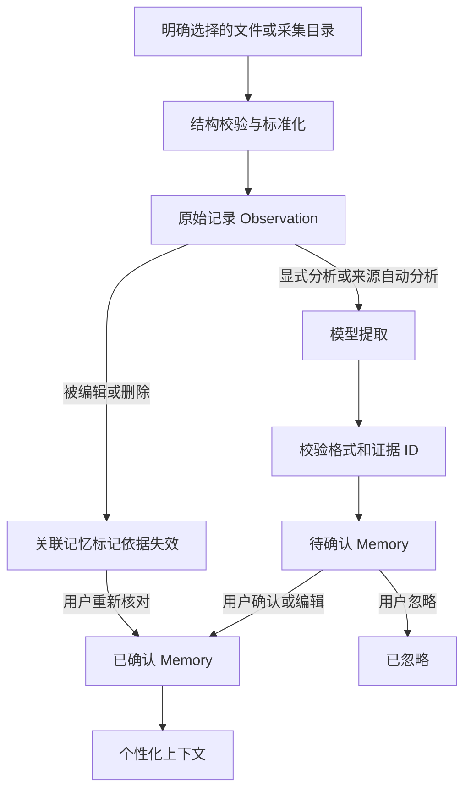
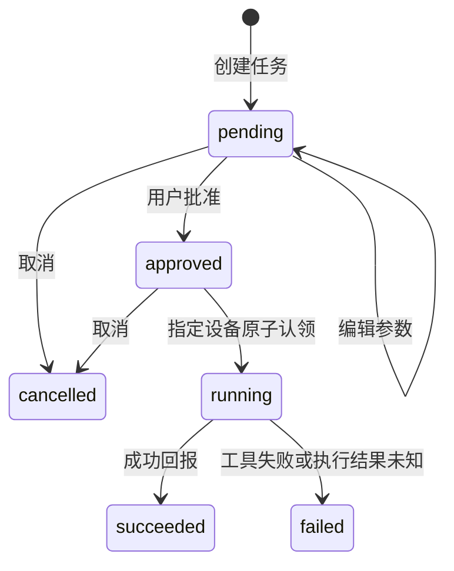

# 架构与数据规则

## 部署边界

后端是单用户服务，多台设备以同一身份连接同一份数据库。服务器只负责数据、提取、任务状态；不会执行客户端工具。设备与 UI 通过类型化 RPC 调用业务服务。实体与请求/结果 schema 位于 contracts，handler 映射同时约束参数与返回值；服务端输出和客户端输入都验证响应，多数响应对象忽略额外字段，关键身份及工具结构严格校验；缺少必需字段或类型不兼容时返回 `INVALID_RESPONSE`。后端 `POST /rpc` 需要 bearer token；SSH 模式下 token 只保存在服务器，SSH 公钥决定哪些设备能调用网关。

浏览器只访问本机 bridge；SSH、文件系统与进程 API 位于 `/node` 入口，不能被浏览器入口引入。`@qiyi/adapters` 根入口没有 Node 依赖：网页上传和后台采集共用解析注册表、`uploadObservations` 和核心 `AdapterRuntime`；Node 配置工厂负责目录、固定命令和诊断文件。React 页面的状态不承担服务端规则，直接调用 API 的 Agent 受到同样校验。

网关处理单个 JSON 请求，向本机后端转发后退出。它不直接打开数据库，因此多个 SSH 连接不会启动多套业务后台。所有数据放在 stdin，远端命令只来自本机受信配置。开发模式允许直接本机 HTTP；远端明文 HTTP 会被客户端拒绝。

`apps/server/src/mcp` 是后端内置的 Streamable HTTP MCP 模块，使用官方 TypeScript SDK。`/mcp` 与 `/rpc` 由同一个服务器进程提供；MCP 通过共享客户端校验结果，并在进程内调用 `AssistantService.dispatch`，不经过 SSH、子进程或内部 HTTP。它不依赖 React、bridge 或目录采集器。四个工具的输入/结果复用 contracts，查询工具只返回确认资料或设备工具列表，写工具只提交偏好候选或待批准任务。没有任意 RPC、确认、批准或执行入口。

后端读取 `.env` 和可选的 `.env.mcp`；设置 `MCP_URL` 与独立的 `MCP_TOKEN` 才启用 MCP，缺少其中之一会启动失败，两者都不设置时保持关闭。`MCP_TOKEN` 必须与管理 `API_TOKEN` 不同。远端 URL 必须是 HTTPS `/mcp`，仅 loopback 允许明文 HTTP。服务器仍默认监听 loopback，由 HTTPS 反向代理只暴露 `/mcp`。路由检查配置的公共 Host 和 Origin，忽略 `X-Forwarded-*` 作为信任来源；代理须保留原始 Host。认证、错误映射和 1 MiB 请求体限制封装在 MCP 插件内，不污染管理路由。`deploy/Caddyfile` 提供部署模板。

MCP 交换无会话状态，每次请求创建协议实例。旧版协议允许单次 SSE 响应；不开放长期订阅。HTTP 断连或关服会释放协议实例及响应读取器，但已经接受的业务写入仍可能完成；调用方通过原 `requestId` 重试获知当前结果。所有 MCP 响应保留 `Cache-Control: no-store`。

## 数据生命周期

- **来源**保存可扩展的格式标识、启用状态与是否自动分析；格式解析器由宿主注册。暂停同时阻止上传和提取。已有数据的来源不能直接切换格式。
- **原始记录**通过 `(sourceId, externalId, keyVersion)` 去重。聊天的不可编辑 `identity` 保存会话与消息元组，新键使用长度编码；旧键保留在独立命名空间。内容指纹涵盖角色、种类、发生时间、文本和元数据，元数据键顺序不影响指纹。相同输入跳过；未手工编辑的记录可由采集端更新。
- **人工编辑**设置 `edited`，后续采集不能覆盖。编辑或删除证据会给所有关联记忆设置 `evidenceStale`，这些资料暂不进入个性化结果。
- **删除原始记录**保留 ID 防复活标记，不保留文本。即便同一来源被删除后重新创建、后台重新扫描旧文件，也不会恢复该记录。防复活标记不在普通 JSON 导出中，但保存在数据库备份里。
- **人工记忆**可独立存在；AI 候选不修改任何已有记忆。相同分类、标题、内容的重复候选会跳过，已忽略候选也不会被相同内容重复建议。语义相似但文字不同的候选暂不自动合并，交由用户判断。
- **Agent 提议**由专用接口首次创建为 `origin=agent` 的待确认偏好，不能直接覆盖已有资料。偏好及任务提议按操作类型与 UUID 请求 ID 保存幂等回执，创建和回执在同一事务提交。重复请求返回经过人工编辑或审批后的当前记录；改变参数会被拒绝，删除后不会重建。回执保留在 SQLite 完整备份中，不在业务 JSON 导出中。
- **分析结果**只使用当前批次中的有效证据 ID。模型运行期间原始记录被编辑、删除或来源被暂停时，整批结果作废。候选写入和输入分析标记处于同一事务，不会部分成功。
- **个性化上下文**仅包含已确认且证据未失效的记忆，按关键词命中和置信度排序。没有向量索引或自动注入 Codex 提示词；其他 Agent 显式调用 `context.get` 或读取导出的 Markdown。

个人资料、来源、记录、任务采用递增 `revision` 防止多设备静默覆盖。版本过期返回 `CONFLICT`，调用方应重新读取并让用户合并自己的修改，不能自动覆盖。

## 工具执行

每个任务指定设备与已注册工具。创建、修改和批准要求工具可用；取消只要求任务状态及版本允许，因此下线工具不会留下无法取消的队列任务。认领事务把 `approved` 改为 `running`，同时生成只有认领响应可见的随机令牌。多个进程同一时刻只能有一个认领成功；普通快照和 JSON 导出不泄漏令牌。

工具执行后若回报失败，运行器保留回报，在下一轮先重发结果，不重复执行操作。服务端允许相同令牌与相同结果的幂等回报。已结束、已删除或令牌冲突等不可重试回报会先由 Node 宿主归档到输出目录的 `report-conflicts/`，再释放同步循环；不会再次执行原任务。运行超过五分钟没有回报的任务会标记为结果未知的失败，不自动重新排队。进程崩溃后的结果不能被假定为“未执行”，需检查本机产物再创建新任务。这是保守的至多一次派发语义，不宣称跨任意外部 App 的 exactly-once。

内置笔记文件名基于任务 ID，固定在配置的输出目录，采用独占创建，重试只接受内容一致的已有文件。命令适配器使用固定可执行文件和参数、`shell: false`、JSON stdin、60 秒时限和有界输出。服务器不能把一个任意命令通过任务参数传给本机 shell。

## 持久化与运行约束

SQLite 通过 Node 自带 `node:sqlite` 使用 WAL、事务与 schema version；业务文档存为经 Zod 校验的 JSON。正常部署只运行一个后端进程，网关共享该进程。当前列表查询与部分分析筛选在内存完成，适合个人使用规模；大量长期日志应先做归档与分页索引优化，再考虑迁移独立数据库。

目录指纹是运行器内存优化，重启后会重扫配置目录，由服务端幂等去重。离线时数据仍在原始日志文件中，下次定时轮询再同步；尚无独立持久化的客户端离线队列。扫描只处理 `.jsonl`，不跟随符号链接，文件末尾未以换行终止的行等待下次扫描。

当前安全边界是可信个人设备，而不是不可信多租户：持有服务器 API 身份或 SSH 密钥的宿主具有完整 API 权限；只持有 MCP 令牌的调用方只能使用其四个工具。需要多人部署时，必须先引入账户隔离、分角色凭证与按用户分区存储。

## 版本迁移与兼容

数据库从 schema 1 到 2 在事务内迁移导入索引，保留旧删除标记，并清理旧模型可能写入的空白标签（去除纯空白、修剪标签边缘，增加记录 revision）。旧程序会拒绝打开更高版本数据库；部署前备份数据库，回退应恢复备份，不能用旧程序直接写新版库。

新版聊天首次重扫时，在有充分身份依据的情况下沿用旧记录 ID、人工修改、分析标记和证据关联；仅按旧 `externalId.trim()` 规则匹配遗留身份，不对全新 v2 身份做 trim。旧客户端发送的无 identity 记录可以沿唯一的已迁移身份同步；无法区分多个 v2 身份时返回 `LEGACY_ID_AMBIGUOUS`，不会任意覆盖。旧删除键缺少原始元组时保守阻止其可能的别名复活；新版删除另外记录只供旧客户端使用的别名标记，不妨碍不同的新 v2 身份。

原先已经被碰撞覆盖而丢失的文本无法凭数据库还原；新版重扫仍保留的原始日志可以重新导入对应消息。共享库交付、开发条件导出与 CI 见 [打包说明](packaging.md)。
